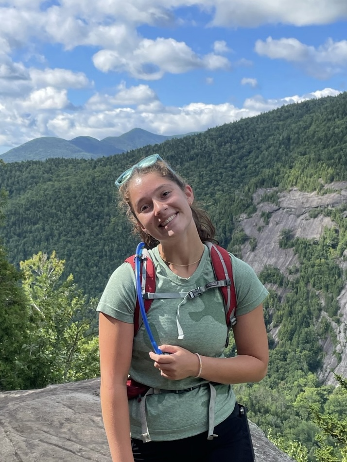

+++
date = '2026-11-20T19:46:13-06:00'
draft = false
title = ''
+++

## About the Authors

#### Warren Kozak

#### Noah Lee

I am Noah and I am a CS major applying to grad school with the hopes of researching reinforcement learning. Check out my <a href="https://leen.people.sites.carleton.edu/" target="_blank">website</a>. On this project, I made the flask app to get the ranges for light/medium/heavy dust, worked on implementing and making evaluation scripts for SegFormer.

#### Nora Wootten

Hi! I'm Nora and right now I am a senior at Carleton majoring in Math and Computer Science. During this project I managed data preprocessing steps and also assisted with portions of U-Net, including the visualization of the activation feature maps. On campus I am a member of Carleton's DIII Swim Team and the Director the Triathlon Committee. You can also visit my <a href="https://norawoots.github.io/" target="_blank">website</a>. We hope you enjoy learning about our Comps!

#### Isaac Lund
